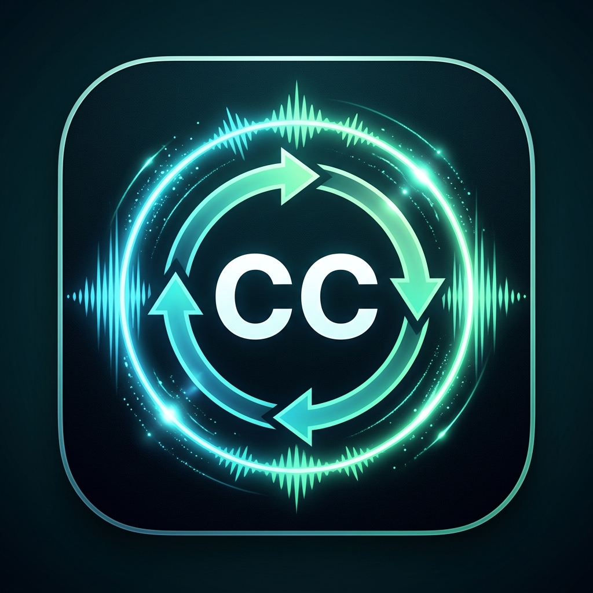
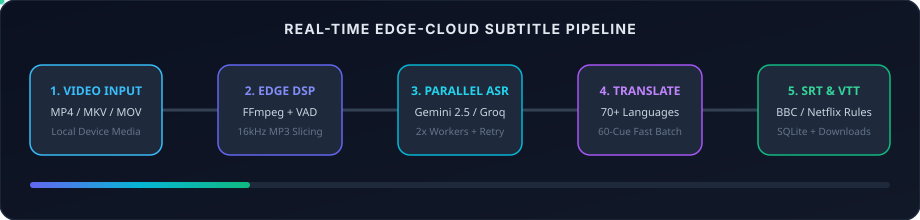
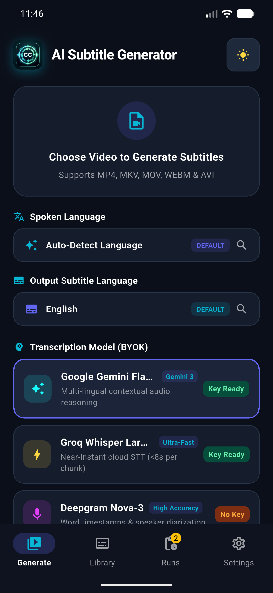
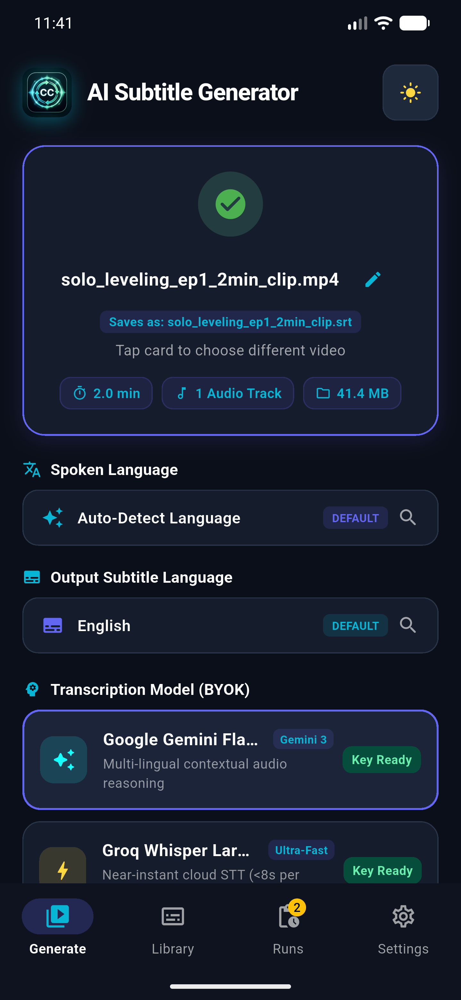
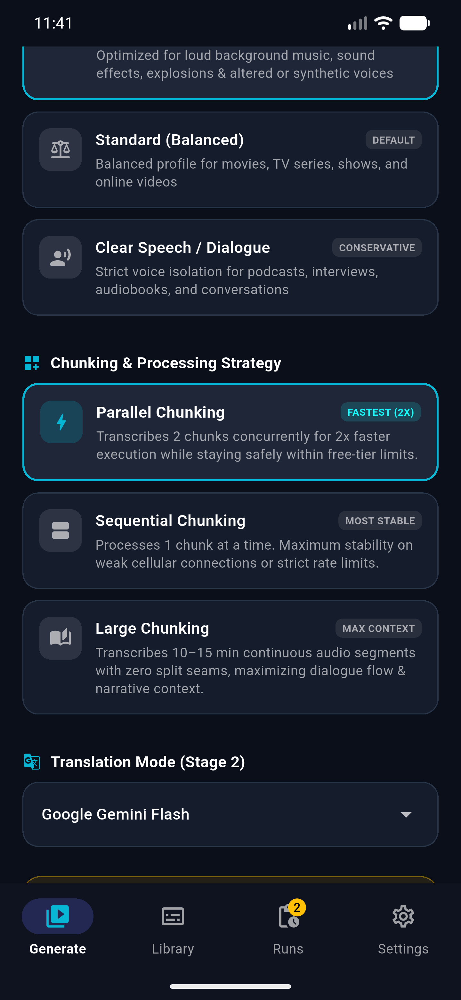
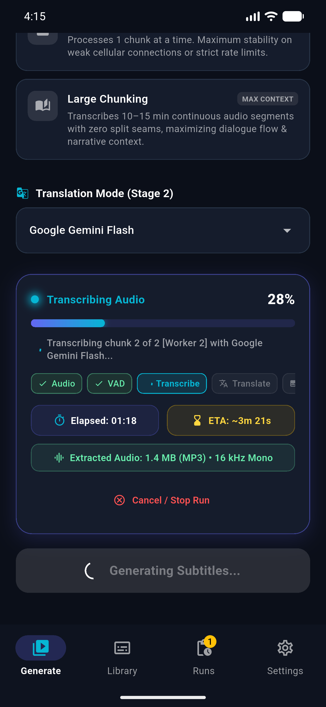
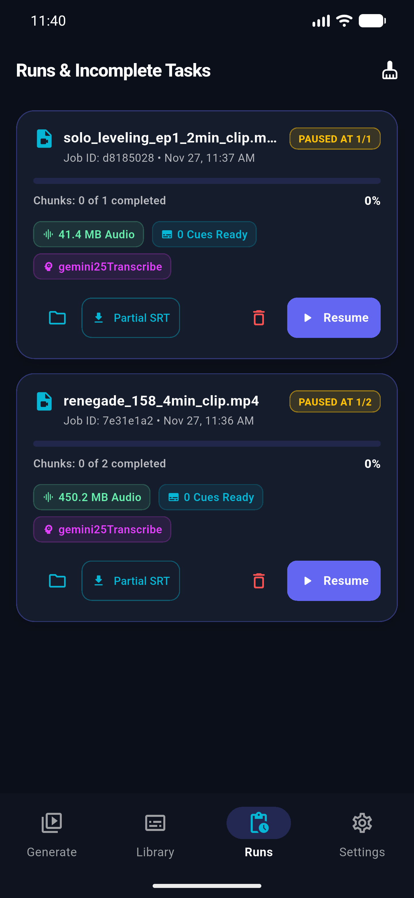
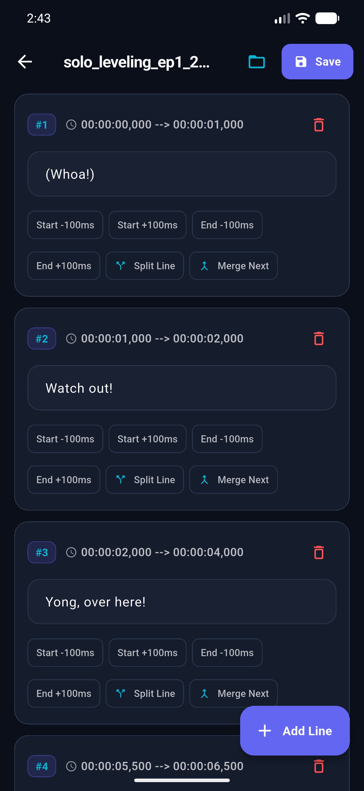
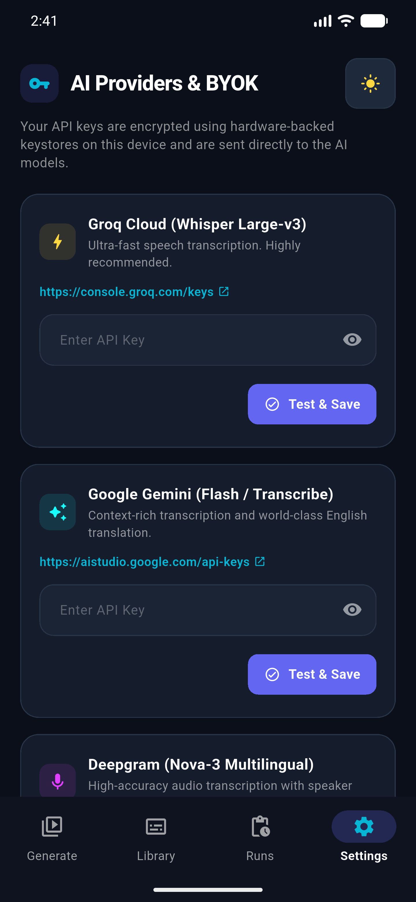

<p align="center">
  
</p>

<p align="center">
  
</p>

<p align="center">
  <a href="https://github.com/AdityaPatra-dev/subtitle_generator/releases"></a>
  <a href="https://hub.docker.com/r/adityapatra/subtitle-generator"></a>
  <a href="https://flutter.dev"></a>
  <a href="https://github.com/AdityaPatra-dev/subtitle_generator/blob/main/LICENSE"></a>
</p>

<p align="center">
  
</p>

<p align="center">
  <a href="https://flutter.dev"></a>
  <a href="https://dart.dev"></a>
  <a href="https://github.com/AdityaPatra-dev/subtitle_generator/releases"></a>
  <a href="https://hub.docker.com/r/adityapatra/subtitle-generator"></a>
  <a href="https://www.linux.org/"></a>
  <a href="https://ai.google.dev"></a>
  <a href="https://groq.com"></a>
</p>

---

## 🌟 Overview

**SubtitleGen AI** is an autonomous, privacy-first cross-platform application (Android, Linux desktop, Windows, macOS, and Docker CLI) engineered to generate broadcast-quality subtitles (`.srt` / `.vtt`) from **long-form audio and video** (from short clips up to 3+ hour films).

Featuring **70+ output subtitle languages**, **smart speech and audio profiles**, and a resilient **chunk-level checkpoint/resume architecture**, SubtitleGen AI combines deterministic Edge audio DSP (FFmpeg, dynamic normalization, silence-based VAD) with cloud intelligence using your personal API keys (**BYOK**), tuned specifically to run reliably on **free-tier APIs**.

---

## ⚡ Animated Pipeline & Live Speedups

<p align="center">
  
</p>

<p align="center">
  
</p>

---

## 📱 App Screenshots (Live Emulator Testing)

<table>
  <tr>
    <td align="center" width="25%">
      <br/>
      <b>1. Generate Home</b><br/>
      <sub>Select video, language &amp; BYOK engine</sub>
    </td>
    <td align="center" width="25%">
      <br/>
      <b>2. Media Probe</b><br/>
      <sub>Duration, audio tracks &amp; file size</sub>
    </td>
    <td align="center" width="25%">
      <br/>
      <b>3. Profiles &amp; Strategy</b><br/>
      <sub>Action mode + 2x parallel chunking</sub>
    </td>
    <td align="center" width="25%">
      <br/>
      <b>4. Live Progress</b><br/>
      <sub>Real-time stages, elapsed &amp; ETA</sub>
    </td>
  </tr>
  <tr>
    <td align="center" width="33%" colspan="1">
      <br/>
      <b>5. Runs &amp; Resume</b><br/>
      <sub>SQLite checkpoints &amp; partial SRT export</sub>
    </td>
    <td align="center" width="33%" colspan="2">
      <br/>
      <b>6. Built-in Cue Editor</b><br/>
      <sub>±100ms timing nudge, split, merge &amp; add</sub>
    </td>
    <td align="center" width="33%" colspan="1">
      <br/>
      <b>7. BYOK Keystore</b><br/>
      <sub>Test &amp; save Gemini, Groq &amp; Deepgram keys</sub>
    </td>
  </tr>
</table>

---

## 🚀 Key Features

- 🎯 **Speech & Audio Profiles**:
  - **Action & Loud Audio Mode**: Dynamic audio normalization (`dynaudnorm`) and aggressive `-20dB` VAD threshold. Captures rapid dialogue, shouting, and altered voices even through heavy combat sound effects, explosions, and loud background music.
  - **Standard (Balanced) Mode**: `-30dB` VAD threshold optimized for general movies, TV series, and online videos.
  - **Clear Speech / Dialogue Mode**: `-38dB` VAD threshold with vocal bandpass filter for podcasts, interviews, and courses.
- ⚡ **Free-Tier Optimized Gemini Engine**:
  - Prioritizes verified free-tier models (`gemini-2.5-flash` → `gemini-3-flash-preview` → `gemini-flash-lite-latest`) with instant `503` demand-spike failover, fast `60–65s` mobile timeouts, and `thinkingBudget: 0` on Stage 2 text translation (while keeping thinking enabled on Stage 1 audio reasoning).
- 🌍 **70+ Output Subtitle Languages**:
  - Searchable picker covering English, Hindi, Japanese, Chinese (Simplified/Traditional), Spanish, French, German, Arabic, Korean, and dozens more.
  - Instant zero-token auto-bypass when source matches target language.
- 🎧 **Silence-Aware VAD Audio Slicing**: FFmpeg `silencedetect` splits long media around natural pauses without cutting sentences midway.
- 🔄 **Chunk-Level Checkpoint & Resume**:
  - Extracted audio is cached persistently; chunk progress is stored in local SQLite. Interruptions or app restarts resume right where they left off with zero wasted API calls.
- 📋 **Runs & Incomplete Tasks Management**: Dedicated tab to monitor active pipelines, inspect completed chunk counts, export partial `.srt`, or resume interrupted tasks.
- 🎙️ **Multi-Engine ASR**: Switch dynamically between **Google Gemini 2.5 Flash**, **Groq Whisper Large-v3**, and **Deepgram Nova-3**.
- 📐 **Broadcast Standard Formatting**: Adheres strictly to **BBC & Netflix Subtitle Guidelines** ($\le 42$ characters/line, natural breath breaks, millisecond timecodes).
- 🐳 **Docker CLI & Multi-Platform**: Run headlessly anywhere via Docker or natively on Android, Linux, Windows, and macOS.
- 🔒 **BYOK Privacy & Security**: Keys stored in hardware-backed secure storage (`Android Keystore` / `Linux Secret Service`). Your video never leaves your device.

---

## 📚 Detailed Documentation (`docs/`)

Deep-dive technical guides covering every subsystem in SubtitleGen AI:

| Guide | What It Covers |
| :--- | :--- |
| **[01. Architecture & End-to-End Pipeline](docs/01_architecture_and_pipeline.md)** | `MainNavigationShell`, `PipelineCoordinator` 6-stage lifecycle, 2x parallel worker pool, resume checkpoints & ETA |
| **[02. Edge Audio DSP & VAD Chunking](docs/02_audio_dsp_and_vad_chunking.md)** | `FFmpegKitMediaEngine` vs `ProcessMediaEngine`, `SpeechProfile` filters, `VadChunkCalculator` & 20 MB cap |
| **[03. Cloud ASR & Translation](docs/03_cloud_asr_and_translation.md)** | `GeminiProvider` free-tier cascade & `503` failover, `GroqWhisperProvider`, `DeepgramProvider`, `TranslationService` |
| **[04. Storage, BYOK Security & Subtitles](docs/04_storage_security_and_subtitles.md)** | Drift SQLite schema, `AudioCacheManager`, hardware-backed keystore, `SubtitleLineBreaker` & `SubtitleSerializer` |
| **[05. UI Screens, Cue Editor, CLI & CI/CD](docs/05_ui_editor_and_cli.md)** | All 5 Flutter screens, ±100ms Cue Editor, `bin/cli.dart`, Docker & GitHub Actions workflows |

---

## 🏗️ Architecture & Workflow

```mermaid
flowchart TD
    A["🎬 Raw Video (MP4 / MKV / MOV)"] --> B["⚙️ Edge Media Engine (FFmpeg / AVAsset)"]
    B --> C["🎵 Loudness Normalization & Filtering\n(16kHz mono, EBU R128 / dynaudnorm)"]
    C --> D["✂️ Silence-Aware VAD Chunking\n(Midpoint silence split, 20MB hard-cap)"]

    subgraph Cloud ASR ["Stage 1: Speech-to-Text (BYOK)"]
        E1["⚡ Google Gemini 2.5 Flash (+ 3-Flash / Lite Failover)"]
        E2["⚡ Groq Whisper Large-v3"]
        E3["⚡ Deepgram Nova-3"]
    end

    D --> Cloud ASR
    Cloud ASR --> F["🧩 Chunk Stitcher & Time Offset Realignment"]

    subgraph Cloud Translation ["Stage 2: Batched LLM Translation"]
        G1["🧠 Gemini 2.5 Flash (60-cue fast batch)"]
        G2["🧠 Groq LLaMA 3.3 / Qwen"]
    end

    F --> Cloud Translation
    Cloud Translation --> H["📐 Subtitle Formatter & Line Balancer\n(BBC/Netflix ≤42 chars/line)"]
    H --> I["💾 Output .SRT & .VTT Subtitles"]
    H --> J["🗄️ Drift SQLite Local Library"]
```

---

## 📊 Live Verification & Benchmarks

Real-world test benchmarks evaluated on Android Emulator (`Pixel 6 Pro`, API 34) and production video samples:

| Video Title | Source Audio | Duration | Transcriber | Translator | Total Time | Output |
| :--- | :--- | :--- | :--- | :--- | :--- | :--- |
| **Solo Leveling (Full Ep)** | Japanese (`ja`) | **18.0 min** (11 chunks) | Gemini 2.5 Flash (Free Tier) | Gemini 2.5 Flash | **102.4 sec** (259 cues) | Emulator Verified |
| **Solo Leveling (Ep 1 Clip)** | Japanese (`ja`) | **2.0 min** (1 chunk) | Gemini 2.5 Flash (Free Tier) | Gemini 2.5 Flash | **33.8 sec** | Emulator Verified |
| **Soul Land 2 (Ep 177)** | Chinese (`zh`) | 14.9 min (894s) | Groq Whisper Large-v3 | Groq LLM | **196 sec** | [`.srt`](test_samples/output_full_episode/Soul%20Land%202%20The%20Peerless%20Tang%20Sect%20Episode%20177%20Multiple%20Subtitles_1280x720.srt) |
| **Battle Through The Heavens** | Chinese (`zh`) | 30s dialogue | Deepgram Nova-3 | Gemini 2.5 Flash | **4.2 sec** | [`.srt`](test_samples/chinese_btth_dialogue_30s.en.srt) |
| **HUNTC-432 (Film Sample)** | Japanese (`ja`) | 45s dialogue | Deepgram Nova-3 | Gemini 2.5 Flash | **5.1 sec** | [`.srt`](test_samples/japanese_huntc_45s.en.srt) |
| **Solo Leveling (Ep 1)** | Japanese (`ja`) | 45s dialogue | Deepgram Nova-3 | Groq LLM | **3.8 sec** | [`.srt`](test_samples/japanese_solo_leveling_45s.srt) |

### Sample Output Comparison
```srt
1
00:00:01,000 --> 00:00:02,000
Watch out!

2
00:00:02,000 --> 00:00:04,000
Vajra Sword: Iron Hammer!

3
00:00:05,500 --> 00:00:07,000
Dragon Fang Flash!
```

---

## 🛠️ Installation & Setup

### Prerequisites

- **Flutter SDK**: `^3.44.8` / `3.50+` (Channel stable)
- **Dart SDK**: `^3.12.2`
- **FFmpeg**: `ffmpeg` and `ffprobe` installed and on system `$PATH`

#### On Linux (Fedora / RHEL / CentOS)
```bash
sudo dnf install -y ffmpeg libsecret-devel clang cmake ninja-build pkg-config
```

#### On Linux (Ubuntu / Debian)
```bash
sudo apt-get install -y ffmpeg libsecret-1-dev clang cmake ninja-build pkg-config
```

#### On macOS
```bash
brew install ffmpeg
```

---

## 🐳 Docker CLI Quick Start

Run headless anywhere using the official Docker image:

```bash
# Pull the latest Docker image
docker pull adityapatra/subtitle-generator:latest

# Run subtitle generation on a video file
docker run --rm \
  -v $(pwd)/videos:/media/input \
  -v $(pwd)/subtitles:/media/output \
  -e GEMINI_API_KEY="your_api_key_here" \
  adityapatra/subtitle-generator:latest \
  -i /media/input/video.mp4 \
  -o /media/output \
  -s auto \
  -t en \
  -p action
```

See [DOCKERHUB.md](DOCKERHUB.md) for detailed CLI parameters and Docker Compose instructions.

---

### 📦 Development & Local Setup

1. **Clone the Repository**:
   ```bash
   git clone https://github.com/AdityaPatra-dev/subtitle_generator.git
   cd subtitle_generator
   ```

2. **Install Dependencies**:
   ```bash
   flutter pub get
   ```

3. **Configure API Keys (Optional Development File)**:
   Create `.env.development` in project root:
   ```env
   DEEPGRAM_API_KEY=your_deepgram_key_here
   GROQ_API_KEY=your_groq_key_here
   GEMINI_API_KEY=your_gemini_key_here
   ```
   *(Note: API keys can also be configured interactively inside the application's Settings UI).*

4. **Launch the Native Linux Desktop App**:
   ```bash
   flutter run -d linux
   ```

5. **Build the Android Production APK**:
   ```bash
   flutter build apk --release
   ```
   The compiled APK will be located at:
   `build/app/outputs/flutter-apk/app-release.apk`

---

## 🧪 Running Automated Tests

Run the complete test suite:
```bash
# Static analysis & Unit + Widget tests
flutter analyze --no-fatal-infos lib/
flutter test test/unit test/widget_test.dart

# Live integration tests with real audio
flutter test test/integration/live_all_providers_test.dart
flutter test test/integration/live_full_episode_pipeline_test.dart
```

---

## 📂 Project Structure

```
subtitle_generator/
├── android/                 # Android Gradle and Native Manifest
├── docs/
│   ├── 01_architecture_and_pipeline.md
│   ├── 02_audio_dsp_and_vad_chunking.md
│   ├── 03_cloud_asr_and_translation.md
│   ├── 04_storage_security_and_subtitles.md
│   ├── 05_ui_editor_and_cli.md
│   ├── animations/          # Animated SVG architecture & benchmark diagrams
│   └── images/              # Live emulator testing screenshots
├── linux/                   # Linux Desktop CMake & C++ Runner
├── lib/
│   ├── core/
│   │   ├── constants/       # Enums, Provider models, languages
│   │   ├── security/        # Hardware-backed SecureStorageService
│   │   ├── storage/         # Drift SQLite database & table definitions
│   │   └── theme/           # Material 3 Theme & dynamic typography
│   ├── features/
│   │   ├── audio_processing/# VadChunkCalculator & silence parser
│   │   ├── media/           # ProcessMediaEngine (FFmpeg extraction/probing)
│   │   ├── providers/       # Deepgram, Groq Whisper, and Gemini ASR
│   │   ├── subtitles/       # SubtitleLineBreaker, SubtitleCue, Serializer
│   │   ├── transcription/   # PipelineCoordinator (End-to-End Orchestrator)
│   │   └── translation/     # TranslationService (LLaMA/Gemini context-aware)
│   └── presentation/
│       ├── providers/       # Riverpod state notifiers & coordinators
│       ├── screens/         # Home, Library, Runs, Editor, Settings
│       └── widgets/         # Progress bars, drop zones, cue cards
└── test/
    ├── integration/         # Live multi-provider & full-episode tests
    ├── unit/                # VAD calculation, DB lifecycle, Line breaker tests
    └── widget_test.dart     # UI component tests
```

---

## 📜 Subtitle Formatting Compliance

SubtitleGen strictly adheres to international broadcast standards:
- **Maximum Line Length**: 42 characters per line (English / Latin).
- **Line Count**: Max 2 lines per subtitle cue.
- **Reading Speed**: Capped between 15–17 characters per second.
- **Punctuation Break Priority**: Deterministic line breaks at natural pause punctuation (`.` `,` `?` `!` `—` `;`).

---

## 📄 License

Distributed under the **MIT License**. See `LICENSE` for more information.

---

<p align="center">
  Crafted with ❤️ by <a href="https://github.com/AdityaPatra-dev">Aditya Patra</a>
</p>

<p align="center">
  
</p>
