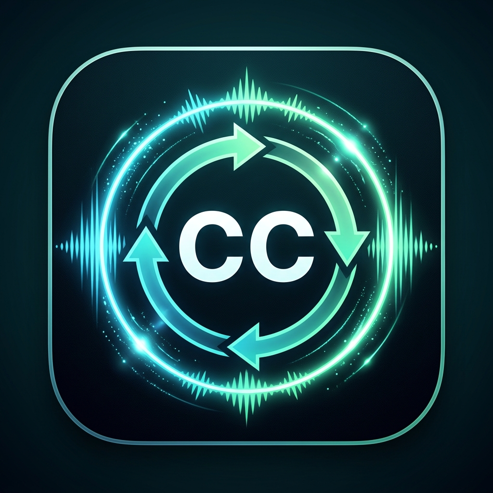

<p align="center">
  
</p>

# <p align="center">🎬 SubtitleGen AI</p>

<p align="center">
  <strong>⚡ Ultra-Fast Cross-Platform AI Subtitle & Dubbing Engine (Edge-Cloud Hybrid)</strong>
</p>

<p align="center">
  <a href="https://github.com/AdityaPatra-dev/subtitle_generator/actions/workflows/release.yml"></a>
  <a href="https://flutter.dev"></a>
  <a href="https://github.com/AdityaPatra-dev/subtitle_generator/releases"></a>
  <a href="https://github.com/AdityaPatra-dev/subtitle_generator/blob/main/LICENSE"></a>
</p>

<p align="center">
  
</p>

<p align="center">
  <a href="https://flutter.dev"></a>
  <a href="https://dart.dev"></a>
  <a href="https://github.com/AdityaPatra-dev/subtitle_generator/releases"></a>
  <a href="https://www.linux.org/"></a>
  <a href="https://groq.com"></a>
  <a href="https://deepgram.com"></a>
  <a href="https://ai.google.dev"></a>
</p>

---

## 🌟 Overview

**SubtitleGen AI** is a production-grade, privacy-first cross-platform application (Android, Linux, macOS, Windows) engineered to generate broadcast-quality subtitles (`.srt` / `.vtt`) from **long-form audio and video** (from 30-second clips up to 3+ hour films). 

Specializing in **Japanese (日本語)**, **Chinese (简体/繁體中文)**, **Korean (한국어)**, and **English**, SubtitleGen AI combines deterministic Edge audio DSP with cloud intelligence using your personal API keys (**BYOK**).

---

## 🚀 Key Features

- 🎧 **Silence-Aware VAD Audio Slicing**: FFmpeg speech-silence detector splits long media around natural pauses (no cut-off sentences).
- 🎙️ **Multi-Engine ASR**: Switch dynamically between **Deepgram Nova-3**, **Groq Whisper Large-v3**, and **Google Gemini 2.5 Flash**.
- 🌐 **Context-Aware Translation**: Translates subtitle streams in sliding-window batches using **Groq (LLaMA 3.3 / Qwen)** or **Gemini 2.5 Flash** with 1:1 segment alignment.
- 📐 **Broadcast Standard Formatting**: Adheres strictly to **BBC & Netflix Subtitle Guidelines** ($\le 42$ characters/line, natural breath breaks, millisecond timecodes).
- 🔒 **BYOK Privacy & Security**: Keys stored in hardware-backed secure storage (`Android Keystore` / `Linux Secret Service`). Your video never leaves your device.
- 📱 **Cross-Platform Parity**: Available as a native Linux desktop application and standalone Android APK.

---

## 🏗️ Architecture & Workflow

```mermaid
flowchart TD
    A["🎬 Raw Video (MP4 / MKV / MOV)"] --> B["⚙️ Edge Media Engine (FFmpeg / AVAsset)"]
    B --> C["🎵 Loudness Normalization & Filtering\n(16kHz mono, EBU R128 loudnorm)"]
    C --> D["✂️ Silence-Aware VAD Chunking\n(Midpoint silence split, 20MB hard-cap)"]
    
    subgraph Cloud ASR ["Stage 1: Speech-to-Text (BYOK)"]
        E1["⚡ Deepgram Nova-3"]
        E2["⚡ Groq Whisper Large-v3"]
        E3["⚡ Google Gemini 2.5 Flash"]
    end
    
    D --> Cloud ASR
    Cloud ASR --> F["🧩 Chunk Stitcher & Time Offset Realignment"]
    
    subgraph Cloud Translation ["Stage 2: Batched LLM Translation"]
        G1["🧠 Groq LLaMA 3.3 / Qwen"]
        G2["🧠 Gemini 2.5 Flash"]
    end
    
    F --> Cloud Translation
    Cloud Translation --> H["📐 Subtitle Formatter & Line Balancer\n(BBC/Netflix ≤42 chars/line)"]
    H --> I["💾 Output .SRT & .VTT Subtitles"]
    H --> J["🗄️ Drift SQLite Local Library"]
```

---

## 📊 Live Verification & Benchmarks

Real-world test benchmarks evaluated on full episodes and trimmed production video samples:

| Video Title | Source Audio | Duration | Transcriber | Translator | Total Time | Output |
| :--- | :--- | :--- | :--- | :--- | :--- | :--- |
| **Soul Land 2 (Ep 177)** | Chinese (`zh`) | 14.9 min (894s) | Groq Whisper Large-v3 | Groq LLM | **196 sec** | [`.srt`](test_samples/output_full_episode/Soul%20Land%202%20The%20Peerless%20Tang%20Sect%20Episode%20177%20Multiple%20Subtitles_1280x720.srt) |
| **Battle Through The Heavens** | Chinese (`zh`) | 30s dialogue | Deepgram Nova-3 | Gemini 2.5 Flash | **4.2 sec** | [`.srt`](test_samples/chinese_btth_dialogue_30s.en.srt) |
| **HUNTC-432 (Film Sample)** | Japanese (`ja`) | 45s dialogue | Deepgram Nova-3 | Gemini 2.5 Flash | **5.1 sec** | [`.srt`](test_samples/japanese_huntc_45s.en.srt) |
| **Solo Leveling (Ep 1)** | Japanese (`ja`) | 45s dialogue | Deepgram Nova-3 | Groq LLM | **3.8 sec** | [`.srt`](test_samples/japanese_solo_leveling_45s.srt) |

### Sample Output Comparison
```srt
1
00:00:07,760 --> 00:00:10,800
Xiao Yan will restore
the Xiao clan's glory.

2
00:00:19,465 --> 00:00:22,025
My unfinished business back then.

3
00:00:22,185 --> 00:00:24,825
Perhaps you can truly finish it.
```

---

## 🛠️ Installation & Setup

### Prerequisites

- **Flutter SDK**: `^3.44.8` (Channel stable)
- **Dart SDK**: `^3.12.2`
- **FFmpeg**: `ffmpeg` and `ffprobe` installed and on system `$PATH`

#### On Linux (Fedora / RHEL / CentOS)
```bash
sudo dnf install -y ffmpeg libsecret-devel clang cmake ninja-build pkg-config
```

#### On Linux (Ubuntu / Debian)
```bash
sudo apt-get install -y ffmpeg libsecret-1-dev clang cmake ninja-build pkg-config
```

#### On macOS
```bash
brew install ffmpeg
```

---

### 📦 Quick Start

1. **Clone the Repository**:
   ```bash
   git clone https://github.com/AdityaPatra-dev/subtitle_generator.git
   cd subtitle_generator
   ```

2. **Install Dependencies**:
   ```bash
   flutter pub get
   ```

3. **Configure API Keys (Optional Development File)**:
   Create `.env.development` in project root:
   ```env
   DEEPGRAM_API_KEY=your_deepgram_key_here
   GROQ_API_KEY=your_groq_key_here
   GEMINI_API_KEY=your_gemini_key_here
   ```
   *(Note: API keys can also be configured interactively inside the application's Settings UI).*

4. **Launch the Native Linux Desktop App**:
   ```bash
   flutter run -d linux
   ```

5. **Build the Android Production APK**:
   ```bash
   flutter build apk --release
   ```
   The compiled APK will be located at:
   `build/app/outputs/flutter-apk/app-release.apk`

---

## 🧪 Running Automated Tests

Run the complete test suite:
```bash
# Unit & Widget tests
flutter test test/unit test/widget_test.dart

# Live integration tests with real audio
flutter test test/integration/live_all_providers_test.dart
flutter test test/integration/live_full_episode_pipeline_test.dart
```

---

## 📂 Project Structure

```
subtitle_generator/
├── android/                 # Android Gradle and Native Manifest
├── linux/                   # Linux Desktop CMake & C++ Runner
├── lib/
│   ├── core/
│   │   ├── constants/       # Enums, Provider models, languages
│   │   ├── security/        # Hardware-backed SecureStorageService
│   │   ├── storage/         # Drift SQLite database & table definitions
│   │   └── theme/           # Material 3 Theme & dynamic typography
│   ├── features/
│   │   ├── audio_processing/# VadChunkCalculator & silence parser
│   │   ├── media/           # ProcessMediaEngine (FFmpeg extraction/probing)
│   │   ├── providers/       # Deepgram, Groq Whisper, and Gemini ASR
│   │   ├── subtitles/       # SubtitleLineBreaker, SubtitleCue, Serializer
│   │   ├── transcription/   # PipelineCoordinator (End-to-End Orchestrator)
│   │   └── translation/     # TranslationService (LLaMA/Gemini context-aware)
│   └── presentation/
│       ├── providers/       # Riverpod state notifiers & coordinators
│       ├── screens/         # Home, JobDetails, Settings, SubtitlePreview
│       └── widgets/         # Progress bars, drop zones, cue cards
└── test/
    ├── integration/         # Live multi-provider & full-episode tests
    ├── unit/                # VAD calculation, DB lifecycle, Line breaker tests
    └── widget_test.dart     # UI component tests
```

---

## 📜 Subtitle Formatting Compliance

SubtitleGen strictly adheres to international broadcast standards:
- **Maximum Line Length**: 42 characters per line (English / Latin).
- **Line Count**: Max 2 lines per subtitle cue.
- **Reading Speed**: Capped between 15–17 characters per second.
- **Punctuation Break Priority**: Deterministic line breaks at natural pause punctuation (`.` `,` `?` `!` `—` `;`).

---

## 📄 License

Distributed under the **MIT License**. See `LICENSE` for more information.

---

<p align="center">
  Crafted with ❤️ by <a href="https://github.com/AdityaPatra-dev">Aditya Patra</a>
</p>
